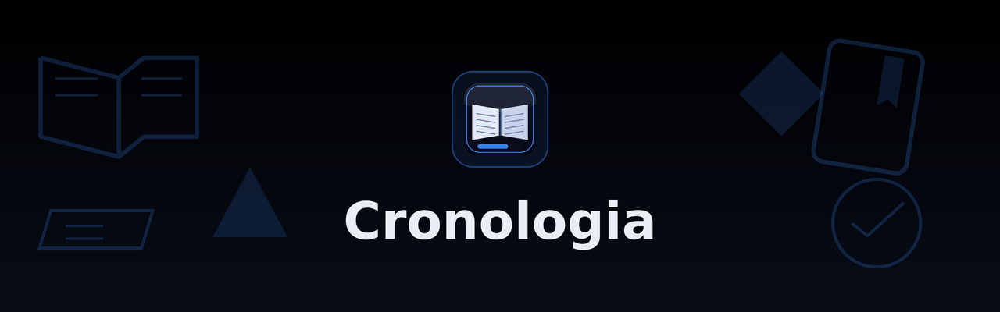

<div align="center">



**Gratuito · Código aberto · MIT** &nbsp;·&nbsp; Electron + React + TypeScript

**Uma biblioteca para acompanhar o que você está lendo:** webtoons, manhwas,
manhuas, mangás e livros com capa, progresso e status, tudo gravado **cifrado**
no seu próprio disco, sem conta e sem servidor.

**Versão atual: 2.3.0 · Linux (amd64)**

[Baixar .deb](https://github.com/user-nome/cronologia/releases/latest/download/cronologia_amd64.deb)
&nbsp;·&nbsp; [Site do projeto](https://cronologia-delirante.vercel.app)

</div>

---

## O que é o Cronologia

O Cronologia é um aplicativo **feito para Linux** que organiza o seu acervo de
leituras e vem em um único arquivo `.deb`, igual a qualquer programa que você
instala pelo gerenciador do sistema. Ele foi feito para quem tem muitas obras
paradas na lista e quer saber, num olhar, onde parou em cada uma.

Ele **organiza** a sua biblioteca; não **lê**. O Cronologia não abre capítulos,
não baixa nada e não substitui o seu leitor: ele guarda o que você leu até onde,
com capa, tipo e status, para você voltar exatamente ali.

A biblioteca é **local**. As obras e as capas são gravadas cifradas no seu
próprio disco e não são enviadas para lugar nenhum, a não ser o backup opcional
que **você** decide configurar. Não existe conta para criar nem servidor para
invadir. Quem tem o aplicativo tem as chaves; quem não tem, não vê nada.

### Suas leituras, em um lugar só

Uma biblioteca com capa, título, tipo, status, categoria e progresso para cada
obra. Nada sai da sua máquina e ninguém, nem nós, vemos o que está dentro.

- **Biblioteca em grade.** Cada obra entra com capa, título, tipo (**webtoon**,
  **manhwa**, **manhua**, **mangá**, **livro** ou outro), status, categoria e
  progresso. O cabeçalho mostra o total e o progresso médio do que está na tela
  agora, e a barra de estatísticas abaixo mostra os da coleção inteira.
- **Capa da obra.** Escolha uma imagem JPG, PNG ou WebP do seu disco. A imagem é
  copiada para a biblioteca local e passa a ser a capa daquela obra.
- **Título, descrição e marcação livres.** O que você precisar escrever: o nome,
  uma sinopse e, se quiser, um marcador como `Cap. 45` ou `Vol. 3`.
- **Categoria por obra.** Uma lista pronta (Isekai, Romance, Ação…) para
  agrupar e achar as obras; o card mostra a categoria e a busca também a
  enxerga.
- **Data de início e de término.** O dia em que você começou e o dia em que
  terminou, escritos com os números que você quiser (`10/02/2026`); o card
  mostra as duas datas.
- **Busca e filtros.** A lista filtra enquanto você digita, pelo título, pela
  descrição ou pela categoria, e pelos chips de status (Lendo, Planejados,
  Pausados, Concluídos, Cancelados).

### Progresso que dá para usar no dia a dia

A parte que você vai usar o dia inteiro, sem trocar de janela nem abrir menu.

- **Ajuste de 1 em 1 no card.** As setas ↑ e ↓ somam ou tiram um capítulo, direto
  no cartão. No modal da obra, o campo numérico e os botões `−10` / `+10` dão
  passos maiores, e ainda há **concluir** e **zerar**.
- **Status com um clique.** O card mostra só as ações que valem para a obra agora:
  **Concluir**, **Pausar** ou **Retomar**, **Cancelar**. Uma obra concluída só
  oferece **Reabrir**; uma cancelada, só **Retomar**.
- **Progresso e status são independentes.** Marcar como concluída **não** apaga o
  número que você anotou: o card passa a mostrar 100% e o valor continua lá. O
  botão **Zerar** volta os dois.
- **Janela nativa, sem barra de menus.** Sem File/Edit/View no topo, com as
  decorações do seu gerenciador de janelas e `F11` para tela cheia.

### Backup na nuvem, cifrado de ponta a ponta

Para o dia em que o disco troca, o computador é formatado ou some. O backup é
**opcional** e só existe se você configurar.

- **Você escolhe o destino.** Dropbox (pasta `/Apps/Cronologia`) ou Google Drive
  (a pasta oculta do app, que não aparece na interface do Google Drive).
- **Login no navegador, sem senha para o app.** A conexão é OAuth direto no
  aplicativo, com PKCE: o login acontece na página da nuvem e o app nunca recebe
  senha sua.
- **O que sobe já está cifrado.** Cada arquivo é criptografado com AES-256-GCM e
  recebe um **nome opaco**, então nem olhando a pasta da nuvem dá para saber o que
  é o quê. O backup sozinho não serve para nada sem a sua senha.
- **Restaurar pede a senha.** O app baixa os arquivos, decifra localmente e
  substitui a biblioteca. Sem a senha do backup, nem nós conseguimos abrir.
- **Acontece quando você manda.** Não existe sincronização automática: o botão
  **Fazer backup agora** grava o que existe naquele momento.

### Proteção contra quem erra o PIN

O PIN é o ponto mais fraco, porque são só 8 dígitos. Por isso o aplicativo torna
cada tentativa errada cara e oferece formas de destruir tudo de vez.

- **Acesso com PIN de 8 dígitos.** O uso do dia a dia é só o PIN. A senha mestra
  de 24 caracteres é a alternativa, e a frase de recuperação que você escreveu na
  criação serve **apenas para escolher um PIN novo**: ela não abre o cofre.
- **Espera crescente e bloqueio automático.** Cada tentativa errada aumenta a
  espera (10 s, 30 s, 1 min, 1 h e depois 24 h), e essa espera fica gravada no
  cofre: fechar o aplicativo não zera nada. Além disso, o cofre **trava sozinho
  após 5 minutos sem uso** e a chave some da memória.
- **Zona de risco.** Apagar a biblioteca, apagar o backup na nuvem e destruir o
  cofre são as três ferramentas irreversíveis, e todas exigem **duas etapas** com
  uma palavra digitada. Arquivos apagados são **sobrescritos** antes de sumir, e
  destruir o cofre torna todo o acervo irrecuperável de uma vez, sem precisar
  percorrer arquivo por arquivo.

## O que o Cronologia não faz

Vale ser claro sobre os limites, porque um organizador de leituras que promete
demais costuma entregar menos do que parece:

- **Não é leitor.** Não abre capítulos, não baixa nada e não substitui o site ou o
  aplicativo de onde você lê. Ele anota onde você parou.
- **Não é nuvem.** Não existe servidor nosso recebendo ou sincronizando sua
  biblioteca. O único tráfego possível é o do backup **que você configurou**.
- **Não sincroniza sozinho.** O backup é manual: nada sai do seu disco sem você
  pedir, e nada volta sem você restaurar.
- **Não importa nem exporta** a biblioteca de outros aplicativos, e não
  sincroniza entre computadores.
- **Não pede cadastro, e-mail ou pagamento.** Não há conta para criar e nada para
  assinar: o aplicativo é gratuito, de código aberto e não mostra anúncios. A
  página **Doar** é um link de contribuição voluntária que abre no navegador —
  não é assinatura, e nada de pagamento acontece dentro do app.
- **Não gera a sua frase de recuperação.** O aplicativo só conta as palavras. Quem
  escreve é você, e ela precisa ficar guardada fora do computador.

## Como funciona o acesso

O cofre é criado uma vez só e, depois, é uma tela de PIN. O caminho tem três
partes, e vale conhecê-las antes de começar:

1. **Na criação** você escolhe uma senha mestra de exatamente 24 caracteres, um PIN
   de 8 dígitos e escreve uma frase de recuperação com pelo menos 12 palavras. A
   frase é sua e precisa ficar anotada no papel, longe do computador.
2. **No dia a dia** você abre o cofre com o PIN. Como ele é o elo mais fraco, o
   aplicativo leva alguns segundos para abrir: essa demora é o que torna um
   ataque por tentativa e erro caro. A biblioteca só existe para o app enquanto o
   cofre está aberto.
3. **Se esquecer o PIN**, a frase de recuperação serve para definir um PIN novo.
   Ela não abre o cofre. E se você perder a senha mestra e a frase ao mesmo tempo,
   a biblioteca não pode ser aberta por ninguém, inclusive por nós, porque não
   temos cópia nenhuma.

## Onde os seus dados ficam guardados

O acervo fica em `~/.local/share/cronologia/` (`library.enc` e `covers/*.enc`), e
as **obras e capas são gravadas cifradas** com a chave do cofre. O idioma fica em
`~/.config/cronologia/settings.json`.

Os **segredos guardados** — os tokens das contas de nuvem, a senha de
criptografia do backup e a chave alternativa do Dropbox, se você usar uma — ficam
em um cofre próprio, em `/var/lib/.cronologia/.vault/`, ou seja, **fora da sua
pasta pessoal**. Isso é de propósito: ele não é apagado quando você limpa a pasta
do usuário e não entra por acaso nos backups sincronizados da nuvem. A pasta é
protegida pelo sistema e só o seu usuário consegue abrir.

A senha mestra, o PIN e a frase de recuperação **não são guardados**: eles são o
que **abre** o cofre.

Na primeira vez, o Cronologia pode pedir a senha de administrador pelo **diálogo
padrão do Linux** para criar essa pasta. A senha é digitada no sistema e **nunca
passa pelo aplicativo**. Além disso, o `.deb` instala um perfil **AppArmor** que
limita o app aos diretórios dele e do cofre, e **nega a leitura** de arquivos
sensíveis do seu `home` (`.ssh`, `.gnupg`, `.aws`, `.netrc`, navegadores, o
`keyring`…).

O detalhamento de cada medida, incluindo as que **não** tomamos, está no
[`SECURITY.md`](SECURITY.md) e no mapa por arquivo em
[`docs/seguranca.md`](docs/seguranca.md).

## Instalação

Baixe o `.deb` da [última versão](https://github.com/user-nome/cronologia/releases)
e instale:

```bash
sudo apt install ./cronologia_amd64.deb
```

**Ou, pelo APT**, que é o caminho que recebe as atualizações futuras com um só
`sudo apt upgrade`. Em um sistema Linux compatível com APT, rode uma vez:

```bash
curl -fsSL https://github.com/user-nome/cronologia/releases/latest/download/public.key | sudo gpg --dearmor --yes -o /usr/share/keyrings/cronologia.gpg
echo "deb [arch=amd64 signed-by=/usr/share/keyrings/cronologia.gpg] https://github.com/user-nome/cronologia/releases/latest/download ./" | sudo tee /etc/apt/sources.list.d/cronologia.list
sudo apt update && sudo apt install cronologia
```

O repositório é **flat e vive na própria Release**: os índices assinados e o `.deb`
com nome estável são anexados a cada versão pelo workflow do app, e o endereço
`releases/latest/download/` redireciona sempre para a última; é isso que mantém o
`sudo apt upgrade` funcionando. O passo a passo completo está em
[`docs/distribuicao-apt.md`](docs/distribuicao-apt.md).

Na primeira vez o app abre o **diálogo padrão do sistema** para você digitar a senha
de administrador: é o PolicyKit criando a pasta do cofre com as permissões certas.
A senha nunca passa pelo app.

---

## Solução de problemas

### App parou de funcionar depois de excluir a pasta `/tmp`

O Cronologia (e a maioria dos aplicativos Electron) usa `/tmp` para sockets e
arquivos temporários. Se essa pasta for excluída, o app pode falhar ao abrir ou
parar de responder sem motivo aparente. Restaure o diretório com as permissões
padrão do sistema:

```bash
sudo mkdir -p /tmp
sudo chmod 1777 /tmp
sudo chown root:root /tmp
```

O `mkdir -p` recria a pasta se ela não existir mais; `chmod 1777` devolve o acesso
temporário com bits de execução para todos (sticky bit, o padrão do Linux) e
`chown root:root` devolve a posse ao sistema. O mesmo vale para qualquer outro
aplicativo que passe a falhar depois que `/tmp` for apagada.

### O Google Drive aparece como indisponível

O provedor só aparece no seletor quando o **build** traz a credencial dele embutida.
Um build de desenvolvimento (`npm run dev` ou `npm ci` limpo) não traz, e o app
diz isso no próprio seletor em vez de falhar na hora de conectar. O destino do
backup, nesse caso, é o Dropbox. Detalhes em
[`docs/backup-providers.md`](docs/backup-providers.md).

---

## Privacidade, em uma tela

O aplicativo guarda apenas o que precisa para funcionar. A biblioteca e as capas
são cifradas com AES-256-GCM; o idioma e as preferências ficam em um arquivo de
configuração; e o cofre local guarda os tokens dos provedores conectados e a senha
de criptografia do backup, sempre cifrados.

O Cronologia **não tem telemetria**: não há contagem de uso, nem relato de erro, nem
identificador de máquina. O único tráfego possível é o do provedor de backup que
**você configurou**, e o app só conversa com a nuvem depois que você aperta
**Conectar**, autoriza no navegador da nuvem e define uma senha de backup.

O [site do projeto](https://cronologia-delirante.vercel.app), por sua vez, é só
divulgação: usa métricas agregadas de visita e um cookie que guarda o seu idioma.
Leia a [Política de Privacidade](https://cronologia-delirante.vercel.app/privacidade)
completa e os [Termos de Uso](https://cronologia-delirante.vercel.app/termos).

## Contato

Dúvidas sobre o aplicativo ou sobre privacidade:
[chronos.biblioteca@proton.me](mailto:chronos.biblioteca@proton.me).

## Sobre as traduções

O app está em português (Brasil), inglês, coreano, japonês e chinês simplificado. O
português é o idioma canônico do app. Se algo estiver estranho, abra uma issue no
repositório do projeto.

Quer ajudar a melhorar a tradução? As mensagens do app moram em `src/messages/`, e
as regras estão em [`docs/messages.md`](docs/messages.md).

---

## Arquitetura

Camadas com fronteiras declaradas no ESLint: `src/main/` cuida do acervo, do
cofre, do backup e do IPC; `src/preload/` é a única ponte (`window.api`); e
`src/renderer/` é a interface React, sem acesso a disco, rede ou Node. Os contratos
ficam em `src/types/`, as regras puras que os dois processos precisam concordar em
`src/shared/` e todos os textos em `src/messages/`.

Dentro de `src/` não existe import relativo: todo módulo é referenciado pelo alias
ESM `@zero/*`, declarado uma vez em `tsconfig.base.json` e espelhado nos três
resolvers do projeto (build, testes e Node puro). O diagrama das camadas, o fluxo do
IPC e o ciclo de vida estão em [`docs/arquitetura.md`](docs/arquitetura.md).

## Como protege

| Medida             | Como o app trata                                                                            |
| ------------------ | ------------------------------------------------------------------------------------------- |
| Derivação da chave | Argon2id, custo por método de desbloqueio (o PIN é o mais caro), com salt por coframe       |
| Cifragem           | AES-256-GCM com chave aleatória, HKDF para separar os usos, IV e salt de 128 bits           |
| Chave do cofre     | Vive só na memória do processo principal e nunca sai por IPC                                |
| Acervo em repouso  | `library.enc` e `covers/*.enc` gravados cifrados; sem cofre aberto não há biblioteca        |
| Contra força bruta | Trava exponencial persistida em disco e auto-lock por ociosidade (5 min)                    |
| Backup na nuvem    | Nomes opacos por HMAC e AES-256-GCM; sem a senha do backup, os blobs não dizem nada         |
| Interface          | `contextIsolation`, `sandbox`, CSP, fuses do Electron e navegação presa à página do app     |
| Sistema            | Perfil AppArmor no `.deb`: escrita só nos diretórios do app e do cofre, deny-list de chaves |
| Arquivos apagados  | Sobrescrita com `fsync` antes do `unlink`, sem seguir symlink                               |

O mapa de cada medida por arquivo está em [`docs/seguranca.md`](docs/seguranca.md), e
o texto normativo, com os riscos aceitos e o que está fora de escopo, no
[`SECURITY.md`](SECURITY.md).

## Desenvolvimento

| Comando                 | O que faz                                                             |
| ----------------------- | --------------------------------------------------------------------- |
| `npm run dev`           | Sobe o app em desenvolvimento (hot reload)                            |
| `npm run check`         | typecheck + lint + formatação + auditoria OSV                         |
| `npm test`              | Suíte Vitest                                                          |
| `npm run test:coverage` | A suíte com medição de cobertura (95% **por arquivo** nas 4 métricas) |
| `npm run test:e2e`      | E2E (Playwright) sobre o app compilado e o payload do `.deb`          |
| `npm run dist`          | Gera o `.deb` com electron-builder                                    |

O `test:e2e` e o `test:mutation` **não** entram no `check`: o primeiro abre janela de
verdade e paga Argon2id de produção, e o segundo leva horas. As demais tarefas estão
em [`CONTRIBUTING.md`](CONTRIBUTING.md) e [`AGENTS.md`](AGENTS.md).

## Documentação

Guias e referências, tudo em pt-BR:

| Documento                                              | Conteúdo                                                                           |
| ------------------------------------------------------ | ---------------------------------------------------------------------------------- |
| [`docs/visao-geral.md`](docs/visao-geral.md)           | Visão geral: o que o app é (e o que não é), dependências e glossário               |
| [`docs/arquitetura.md`](docs/arquitetura.md)           | Arquitetura: camadas, aliases `@zero/*`, fluxo de IPC e ciclo de vida              |
| [`docs/telas.md`](docs/telas.md)                       | Telas e componentes do renderer, com os fluxos de navegação                        |
| [`docs/cofre.md`](docs/cofre.md)                       | Cofre: três credenciais, container, cadeia de abertura, trava, sessão e destruição |
| [`docs/credenciais.md`](docs/credenciais.md)           | Segredos do app: o que é guardado, o ciclo de vida e a força de cada credencial    |
| [`docs/dropbox.md`](docs/dropbox.md)                   | Guia do backup: OAuth PKCE, pasta do app e recuperação de problemas                |
| [`docs/backup-providers.md`](docs/backup-providers.md) | Provedores de backup: contrato, catálogo e Google Drive oculto                     |
| [`docs/distribuicao-apt.md`](docs/distribuicao-apt.md) | Distribuição: Release, repo APT flat assinado e fluxo de release                   |
| [`docs/build.md`](docs/build.md)                       | Build e pacote: comandos, `.deb`, fuses e gate de qualidade no CI                  |
| [`docs/seguranca.md`](docs/seguranca.md)               | Mapa de segurança: onde vive cada medida e o que não enfraquecer                   |
| [`docs/messages.md`](docs/messages.md)                 | i18n: bundles de mensagens (pt-BR/en/ko/zh-CN/ja) e regras de tradução             |
| [`docs/testes.md`](docs/testes.md)                     | Testes: como rodar, inventário, convenções e cobertura                             |
| [`docs/e2e.md`](docs/e2e.md)                           | Testes ponta a ponta: app compilado e payload do `.deb` (Playwright)               |
| [`docs/mutation.md`](docs/mutation.md)                 | Testes de mutação: operadores, escopo, garantias e score                           |
| [`docs/atribuicoes.md`](docs/atribuicoes.md)           | Página de Atribuições: créditos em loop e licenças                                 |
| [`docs/doacoes.md`](docs/doacoes.md)                   | Página de Doações: Mercado Pago                                                    |
| [`docs/api.md`](docs/api.md)                           | Referência da API interna (`window.api` + canais IPC)                              |
| [`docs/openapi.yaml`](docs/openapi.yaml)               | Mesma API em OpenAPI 3.1 (abre em Swagger UI/Redoc)                                |
| [`CHANGELOG.md`](CHANGELOG.md)                         | Histórico de mudanças por versão                                                   |
| [`CONTRIBUTING.md`](CONTRIBUTING.md)                   | Como contribuir (ambiente, scripts, convenções)                                    |
| [`SECURITY.md`](SECURITY.md)                           | Política de segurança e como reportar falhas                                       |

## Licença

MIT. Ver [`LICENSE`](LICENSE) e
[`THIRD-PARTY-NOTICES.txt`](THIRD-PARTY-NOTICES.txt) para os componentes
distribuídos.
