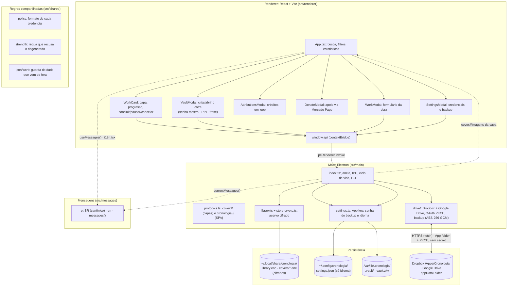
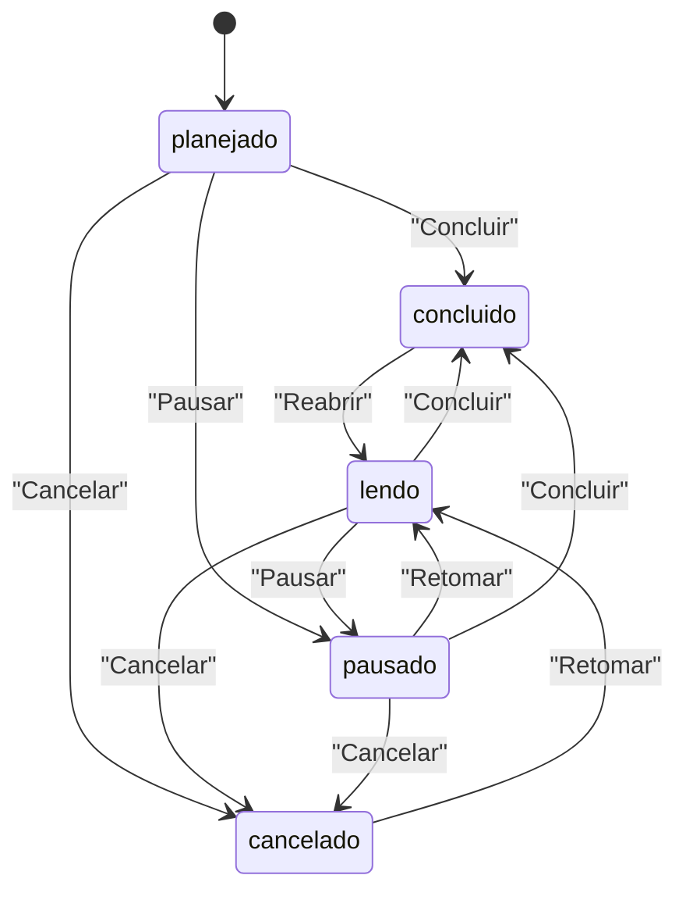
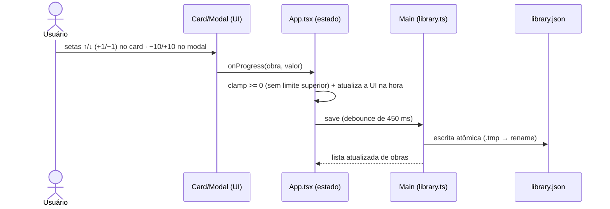
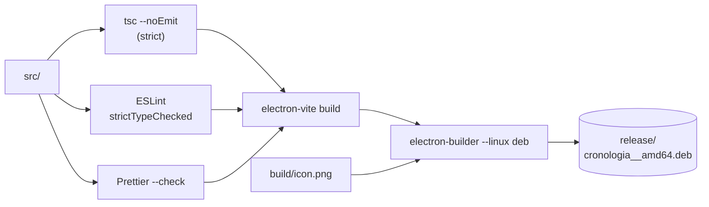
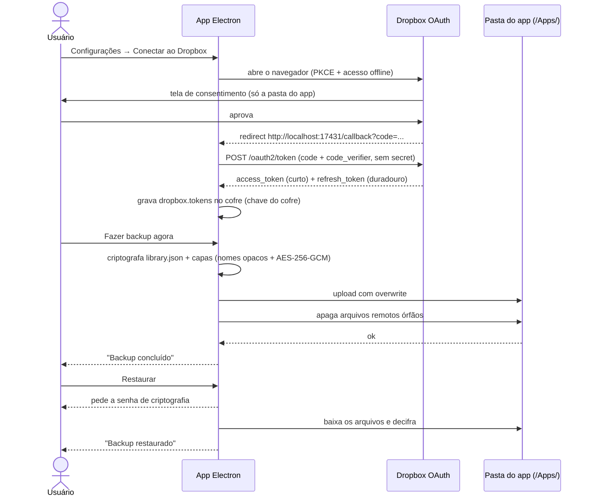

# Cronologia

Aplicativo desktop (Electron + TypeScript + React) para anotar o progresso das suas leituras de
**webtoons, manhwas, manhuas, mangás, livros e outros**: capa da obra, título, descrição, barra de
progresso em capítulos e marcação de conclusão, com **backup manual no Dropbox ou Google
Drive**.

Feito para **Linux Mint 22.3 (Zena)** e distribuído como pacote **`.deb`**.

---

## Recursos

- **Cofre com três credenciais**: obras e capas são gravadas **cifradas** em disco
  (AES-256-GCM com a chave do cofre). A chave é abrada por uma **senha mestra** de
  24 caracteres, por um **PIN** de 8 dígitos no dia a dia, e por uma **frase de
  recuperação** de 12+ palavras que não abre o cofre: ela só redefine o PIN
  esquecido. Sem cofre aberto o acervo não existe para o app, e o auto-lock de 5
  min de inatividade fecha a sessão. Ver [`docs/cofre.md`](docs/cofre.md).
- **Zona de risco**: apagar a biblioteca, apagar o backup na nuvem e destruir o
  cofre, cada uma em duas etapas com palavra digitada. Arquivos apagados são
  sobrescritos antes, e destruir o cofre torna todo o acervo irrecuperável sem
  precisar sobrescrever cada arquivo.
- **Biblioteca em grade** com capa, título, tipo (webtoon/manhwa/manhua/mangá/livro/outro), status
  (planejado, lendo, pausado, concluído, cancelado) e progresso.
- **Capa da obra**: escolha uma imagem JPG/PNG/WebP do disco. A imagem é copiada para a
  biblioteca local e servida pelo protocolo interno `cover://`.
- **Título e descrição** livres, além de uma marcação opcional (`Cap. 45`, `Vol. 3`).
- **Barra de progresso** no card com setas `↑` / `↓` (ajuste de 1 em 1) e botões de status
  contextuais (**Concluir**, **Pausar**/**Retomar** e **Cancelar**), todos em uma única linha e
  compactos (só ícone, com a ação no tooltip); no modal de edição, campo numérico direto,
  `−10` / `+10`, **concluir** e **zerar**.
- **Busca** por título ou descrição e **filtros** por status (Lendo, Planejados, Pausados,
  Concluídos, Cancelados); o contador e o progresso médio do cabeçalho acompanham o que está
  sendo exibido, e o bloco de estatísticas continua mostrando o total da biblioteca.
- **Backup na nuvem**: Dropbox (`/Apps/Cronologia`) ou Google Drive (`appDataFolder`,
  pasta oculta, disponível quando o build tem `GOOGLE_CLIENT_ID`). Login **OAuth + PKCE
  direto no app**, sem servidor intermediário. Arquivos sempre **criptografados** (nomes
  opacos + AES-256-GCM), com **Fazer backup agora**, **Restaurar** (pede a senha),
  **Desconectar** e **Apagar backup**.
- **Janela nativa sem barra de menus**: sem botões File/Edit/View no topo (menu da
  aplicação removido por completo); decorações do gerenciador de janelas (encaixe em cantos
  para dividir a tela, maximizar/fechar) e `F11` alterna tela cheia.
- **Atribuições**: botão ao lado da pílula do Drive abre os créditos das dependências em
  rolagem lenta e contínua (estilo pós-créditos de cinema), com pausar/continuar e
  respeito a `prefers-reduced-motion`; detalhes em [`docs/atribuicoes.md`](docs/atribuicoes.md).
- **Doações**: botão **Doar** no cabeçalho abre a página de apoio ao projeto, com link do
  Mercado Pago (abre no navegador) e botão de copiar; detalhes em
  [`docs/doacoes.md`](docs/doacoes.md).
- **Idioma**: interface em **português (Brasil)**, **inglês**, **coreano** ou **chinês simplificado**,
  escolhido em Configurações e
  persistido; todo texto fixo mora em `src/messages/` (ver [`docs/messages.md`](docs/messages.md)).
- Tema escuro com fundo preto (`#000`) e paleta sólida azul; ícones **Font Awesome**.

---

## Instalação

### Via repositório APT (recomendado: recebe `sudo apt upgrade`)

O repositório é a própria GitHub Release do projeto (índices assinados como
assets; nada de binário no git). Motivo da escolha, passo a passo da
publicação e regras de manutenção: [`docs/distribuicao-apt.md`](docs/distribuicao-apt.md).

Na primeira instalação:

```bash
curl -fsSL https://github.com/chronos-atalante/cronologia/releases/latest/download/public.key \
  | sudo gpg --dearmor --yes -o /usr/share/keyrings/cronologia.gpg
echo "deb [arch=amd64 signed-by=/usr/share/keyrings/cronologia.gpg] \
https://github.com/chronos-atalante/cronologia/releases/latest/download/ ./" \
  | sudo tee /etc/apt/sources.list.d/cronologia.list
sudo apt update && sudo apt install cronologia
```

### Download direto

Baixe o `.deb` da [página de Releases](https://github.com/chronos-atalante/cronologia/releases)
(baixar direto:
`https://github.com/chronos-atalante/cronologia/releases/latest/download/cronologia_amd64.deb`)
e instale:

```bash
sudo apt install ./cronologia_amd64.deb
```

### Compilando localmente

```bash
# gere o pacote (uma vez)
npm install
npm run dist

# instale
sudo apt install ./release/cronologia_*_amd64.deb
```

O aplicativo aparece no menu do sistema como **Cronologia**.

- Executável: `/opt/Cronologia/cronologia` (alternativa
  `/usr/bin/cronologia`)
- Ícone instalado em `/usr/share/icons/hicolor/512x512/apps/cronologia.png`
- Dados: obras e capas em `~/.local/share/cronologia/` (`library.enc`, `covers/*.enc`), **cifrados** com a chave do cofre;
  configurações em `~/.config/cronologia/` (`settings.json`, só o idioma) e
  cofre de segredos em `/var/lib/.cronologia/.vault/` (raiz `0711 root`, vault
  `0700` do usuário; criado no `postinst` e reparado pelo PolicyKit)

---

## Solução de problemas

### App parou de funcionar depois de excluir a pasta `/tmp`

O Cronologia (e a maioria dos aplicativos Electron) usa `/tmp` para sockets e
arquivos temporários. Se essa pasta for excluída, o app pode falhar ao abrir ou
parar de responder sem motivo aparente. Restaure o diretório com as permissões
padrão do sistema e, em geral, o app volta ao normal:

```bash
sudo mkdir -p /tmp
sudo chmod 1777 /tmp
sudo chown root:root /tmp
```

O `mkdir -p` recria a pasta se ela não existir mais; `chmod 1777` devolve o
acesso temporário com bits de execução para todos (sticky bit, o padrão do
Linux) e `chown root:root` devolve a posse ao sistema. O mesmo vale para
qualquer outro aplicativo que passe a falhar depois que `/tmp` for apagada.

---

## Comandos de desenvolvimento

| Comando                   | O que faz                                                                        |
| ------------------------- | -------------------------------------------------------------------------------- |
| `npm run dev`             | Sobe o app em modo desenvolvimento (hot reload), com log do Chromium no terminal |
| `npm run dev:inspect`     | Igual ao `dev`, com o V8 inspector do processo main na porta 5858                |
| `npm run dev:inspect-brk` | Igual ao `dev:inspect`, mas pausa na primeira linha esperando o depurador        |
| `npm run typecheck`       | `tsc --noEmit` nos projetos node, web, testes e E2E                              |
| `npm run lint`            | ESLint rigoroso (type-aware) em todo o repositório                               |
| `npm run lint:fix`        | ESLint com correção automática                                                   |
| `npm run format`          | Formata tudo com Prettier                                                        |
| `npm run format:check`    | Verifica a formatação (CI)                                                       |
| `npm test`                | Roda a suíte Vitest (`tests/**/*.test.{ts,tsx}`)                                 |
| `npm run test:coverage`   | A suíte com medição de cobertura (95% **por arquivo** nas 4 métricas)            |
| `npm run test:e2e`        | E2E com Playwright: app compilado e payload do `.deb` (veja `docs/e2e.md`)       |
| `npm run test:mutation`   | Varredura de mutação de `src/` (veja `docs/mutation.md`)                         |
| `npm run security:audit`  | Auditoria de vulnerabilidades via OSV Scanner                                    |
| `npm run check`           | `typecheck` + `lint` + `format:check` + auditoria                                |
| `npm run clean`           | Apaga `out/` (build anterior)                                                    |
| `npm run build`           | Limpa + compila main/preload/renderer                                            |
| `npm run dist`            | Build + gera o `.deb` com electron-builder                                       |

O `test:e2e` e o `test:mutation` **não** entram no `check`: o primeiro abre
janela de verdade e paga Argon2id de produção, e a segunda leva horas. Ambos
rodam no CI (`quality.yml`), em jobs próprios.

O `dev:inspect` não existe no app instalado: o fuse
`enableNodeCliInspectArguments` está desligado, para que o usuário não abra um
depurador no processo que tem a chave-mestra em memória. Detalhes de depuração
em [`docs/testes.md`](docs/testes.md) § "Depuração".

---

## Qualidade de código

O projeto roda com o máximo de rigor disponível:

**TypeScript (`tsconfig.base.json`)**

```jsonc
"strict": true,
"module": "nodenext",                // ESM em src/ (src/package.json "type": "module")
"allowImportingTsExtensions": true,  // noEmit: permite candidatos de paths com .ts/.tsx
"noUncheckedIndexedAccess": true,   // acesso a índice vira T | undefined
"exactOptionalPropertyTypes": true, // opcional ≠ undefined explícito
"noImplicitReturns": true,
"noImplicitOverride": true,
"noUnusedLocals": true,
"noUnusedParameters": true,
"noFallthroughCasesInSwitch": true,
"allowUnreachableCode": false,
"verbatimModuleSyntax": true        // imports de tipo obrigatoriamente `import type`
```

**ESLint (`eslint.config.mjs`)**

- `typescript-eslint` nos perfis **`strictTypeChecked`** + **`stylisticTypeChecked`** (analisa
  tipos reais, não só sintaxe).
- Regras extras sempre em **`error`**: `no-floating-promises`, `no-misused-promises`,
  `no-unsafe-*` (assignment/argument/call/member-access/return), `no-unnecessary-condition`,
  `strict-boolean-expressions` (sem coerção implícita: `if (str)` é proibido, use
  `str === ''`), `explicit-function-return-type`, `explicit-member-accessibility`,
  `require-await`, `switch-exhaustiveness-check`, `no-deprecated`,
  `ban-ts-comment` + `prefer-ts-expect-error`, `consistent-type-imports`/`-exports`,
  `only-throw-error` e a lista de armadilhas clássicas (`no-useless-return`,
  `default-case`, `radix`, `no-path-concat`…).
- **Fronteira de camada como regra** (`no-restricted-imports` por camada): cada
  camada declara os aliases que pode importar, e `fs`, `electron` e
  `child_process` são concessão nomeada — o `fs` é do processo main, o
  `electron` só de `index.ts`/`protocols.ts`/`external.ts` (mais o preload), e o
  `child_process` só de `vault/privilege.ts`. `CRONOLOGIA_VAR_LIB`,
  `CRONOLOGIA_VAULT_DIR` e `ELECTRON_RENDERER_URL` só são lidos por
  `vault/vault.ts`, `vault/privilege.ts` e `main/index.ts`.
- **Teto de tamanho** (`max-lines`, pulando linha em branco e comentário): 520 em
  `src/`, 750 em `tests/`, `e2e/` e `tools/`.
- `eslint-plugin-react-hooks` com `rules-of-hooks`, `exhaustive-deps` e as regras
  de compilador que o `recommended-latest` não traz
  (`exhaustive-effect-dependencies`, `memo-dependencies`,
  `memoized-effect-dependencies`, `no-deriving-state-in-effects`, `invariant`,
  `rule-suppression`), todas em `error`.
- `eslint-config-prettier` desliga apenas o que conflita com a formatação.

**Prettier (`.prettierrc.json`)**: 100 colunas, aspas simples, ponto e vírgula, vírgula final,
2 espaços. Rode `npm run check` antes de commitar.

**Três sinais de teste, três perguntas diferentes**:

| Camada              | Pergunta                                                 | Onde              |
| ------------------- | -------------------------------------------------------- | ----------------- |
| Unitária/integrada  | "este módulo faz o que diz?"                             | `tests/**`        |
| Ponta a ponta (E2E) | "o app de verdade funciona depois que tudo monta?"       | `e2e/**`          |
| Mutação             | "se esta linha fizesse outra coisa, a suíte perceberia?" | `tools/mutation/` |

Cobertura de linha é o piso, e ela é **por arquivo** (95% nas quatro métricas,
`perFile: true`): o piso agregado perdoa o arquivo esquecido, e era isso que
acontecia, com o entry do renderer em 0% e o scheme da SPA em 35% antes da
varredura de baixo para cima. A mutação é o que diz se esse piso significa
alguma coisa, e o E2E é o único lugar onde o bundle, o `cronologia://`, o IPC real
e o Argon2id de produção aparecem juntos. Detalhes em
[`docs/testes.md`](docs/testes.md), [`docs/e2e.md`](docs/e2e.md) e
[`docs/mutation.md`](docs/mutation.md).

---

## Imports e aliases

Dentro de `src/` **não existe import relativo**: todo módulo é referenciado por um alias ESM
`@zero/*`. O mapa é declarado uma única vez em `tsconfig.base.json` e espelhado nos três
resolvers que o projeto usa (build, testes e Node puro):

| Alias              | Alvo                     | Onde é resolvido                                        |
| ------------------ | ------------------------ | ------------------------------------------------------- |
| `@zero/types`      | `src/types/` (barrel)    | `electron.vite.config.mts`, `vitest.config.mts`, loader |
| `@zero/types/*`    | `src/types/*`            | `tsconfig.base.json`                                    |
| `@zero/messages`   | `src/messages/` (barrel) | `electron.vite.config.mts`, `vitest.config.mts`, loader |
| `@zero/messages/*` | `src/messages/*`         | `tsconfig.base.json`                                    |
| `@zero/main/*`     | `src/main/*`             | `electron.vite.config.mts`, `vitest.config.mts`, loader |
| `@zero/preload/*`  | `src/preload/*`          | `electron.vite.config.mts`, `vitest.config.mts`, loader |
| `@zero/renderer/*` | `src/renderer/src/*`     | `electron.vite.config.mts`, `vitest.config.mts`, loader |

- **Build** (`npm run dev` / `npm run build`): electron-vite (Vite) resolve os aliases.
- **Testes** (`npm test`): vitest resolve os mesmos aliases. `vitest.e2e.config.mts`
  e `vitest.mutation.config.mts` importam o mapa de `vitest.config.mts` em vez de
  redeclará-lo, então mudar um alias continua sendo uma mudança nos três arquivos
  da tabela.
- Com `module: nodenext`, os candidatos de `paths` em `tsconfig.base.json` declaram a extensão
  (`.ts` / `.tsx` / `index.tsx`); `allowImportingTsExtensions: true` (que exige `noEmit`) é o
  que permite isso sem erro de import.
- **Node puro** (sem bundler): o loader `src/node.loader.ts` registra hooks de resolução com
  `module.registerHooks()`: hooks **síncronos, na mesma thread** (estáveis desde o
  Node 22.15/23.5). O caminho antigo, `module.register()` com hooks assíncronos em thread
  separada (o antigo `--experimental-loader`), está **deprecado** desde o Node 25.9.

```bash
# roda um arquivo .ts direto, com os aliases @zero/* funcionando
node --import ./src/node.loader.ts caminho/para/arquivo.ts
```

O loader só precisa dos aliases: o Node já remove as anotações de tipo dos `.ts` sozinho.
`src/package.json` **e a raiz** declaram `"type": "module"`: o Node lê `src/` como ESM e o
electron-vite emite `out/main/index.js` (ESM). O preload sai como **CommonJS**
(`out/preload/index.cjs`), porque o Electron roda preload **sandboxed** como script simples, sem
loader ESM; por isso `electron.vite.config.mts` fixa `format: 'cjs'` no build de `preload`.
`preloadScript()` em `src/main/index.ts` resolve `index.cjs`, `index.mjs` ou `index.js` nessa
ordem.

---

## Arquitetura



### Estados de uma obra



Os botões do card mostram as transições válidas para o status atual (uma obra `cancelada` só
oferece **Retomar**; uma `concluída`, só **Reabrir**). No modal de edição, o Select de **Status**
permite ir de qualquer estado para qualquer outro, e **Zerar** volta o progresso para 0 e o status
para `planejado`. Mexer no progresso de uma obra `concluída` a devolve para `lendo`.

Progresso e status são independentes: marcar `concluido` **não** altera o número salvo, o card
apenas passa a exibir `100%` (use **Zerar** no modal para voltar a 0).

### Fluxo do progresso (anotação contínua)



---

## Estrutura do projeto

```
cronologia/
├── build/
│   ├── after-pack.cjs        # slim do pacote (locales/SwiftShader; nunca libffmpeg)
│   ├── apparmor-profile      # perfil AppArmor real instalado no .deb
│   ├── icon.png              # ícone 512×512 usado no .deb
│   ├── make-icon.py          # gerador do ícone (PIL)
│   ├── scripts/
│   │   ├── after-install.sh   # postinst: dirs do cofre em /var/lib + ação do PolicyKit
│   │   └── cronologia-setup   # helper root (pkexec) que só cria os dirs do cofre
│   └── postrm                # after-remove: unload do perfil, alternatives, policy e purge
├── docs/
│   ├── visao-geral.md          # visão geral: o que é/não é, dependências, glossário
│   ├── arquitetura.md          # camadas, aliases @zero/*, IPC e ciclo de vida
│   ├── telas.md                # telas e componentes do renderer
│   ├── dropbox.md              # guia do backup + diagramas
│   ├── cofre.md                # cofre: três credenciais, container v2, cadeia, trava, sessão
│   ├── credenciais.md          # segredos do app: o que é guardado, ciclo de vida e força
│   ├── backup-providers.md     # provedores de nuvem (Dropbox · Google Drive)
│   ├── distribuicao-apt.md     # distribuição: Release + repo APT flat assinado
│   ├── build.md                # build, .deb, fuses e o gate de qualidade no CI
│   ├── seguranca.md            # mapa de segurança (medida → arquivo)
│   ├── messages.md             # i18n: bundles pt-BR/en/ko/zh-CN/ja e o que não se traduz
│   ├── testes.md               # testes: como rodar, inventário, convenções, cobertura
│   ├── e2e.md                  # testes ponta a ponta (app compilado + payload do .deb)
│   ├── mutation.md             # testes de mutação: operadores, escopo e garantias
│   ├── atribuicoes.md          # página de Atribuições (créditos em loop)
│   ├── doacoes.md              # página de Doações (Mercado Pago)
│   ├── api.md                  # referência da API interna
│   └── openapi.yaml            # a mesma API em OpenAPI 3.1
├── src/
│   ├── main/                 # processo main (Electron)
│   │   ├── index.ts          # janela, IPC, ciclo de vida e F11 em tela cheia
│   │   ├── protocols.ts      # schemes cover:// (capas) e cronologia:// (SPA)
│   │   ├── library.ts        # acervo cifrado + reset destrutivo
│   │   ├── settings.ts       # App key, idioma e leitura/gravação no cofre
│   │   ├── jsonfile.ts       # writeJsonAtomic (escrita atômica com mode)
│   │   ├── paths.ts          # diretórios XDG do app (sem dependências de domínio)
│   │   ├── external.ts       # openExternalSafe (só https:)
│   │   ├── i18n.ts           # currentMessages() (idioma corrente no main)
│   │   ├── vault/            # cofre de segredos (três credenciais, container, sessão)
│   │   │   ├── crypto.ts     # Argon2id, AES-256-GCM, HKDF e perfis de custo por credencial
│   │   │   ├── container.ts  # formato CHRONOS1 v2 (um embrulho por credencial)
│   │   │   ├── store.ts      # caminho, leitura/gravação do container e guarda pós-destruição
│   │   │   ├── wrapping.ts   # Strategy de embrulhar a chave por credencial
│   │   │   ├── unlock.ts     # cadeia de desbloqueio (trava → formato → KDF → integridade)
│   │   │   ├── auth.ts       # tentativas e projeção do estado para a interface
│   │   │   ├── lockout.ts    # rampa de espera exponencial
│   │   │   └── session.ts    # chave na memória, auto-lock e wipe
│   │   └── drive/            # provedores de nuvem, OAuth PKCE, backup/restauração
│   │       ├── index.ts      # barrel da API pública (authorize, backupNow…)
│   │       ├── provider.ts   # contrato BackupProvider + catálogo de provedores
│   │       ├── providers/    # Dropbox e Google Drive (appDataFolder)
│   │       ├── oauth-flow.ts # PKCE + loopback compartilhados
│   │       ├── constants.ts  # escopos, endpoints, loopback fixo
│   │       ├── dropbox-credentials.ts # App key injetada no bundle main
│   │       ├── state.ts      # sessão, App key e listener de status
│   │       ├── oauth.ts      # autorização (PKCE sem secret) + refresh
│   │       ├── rest.ts       # chamadas REST do Dropbox (pasta do app)
│   │       ├── json.ts       # leitura tipada de corpos JSON (`parseJson`)
│   │       ├── crypto.ts     # AES-256-GCM do backup
│   │       └── backup.ts     # backup, restauração e desconexão
│   ├── messages/             # textos do app (i18n): pt-BR (canônico) + en + ko + zh-CN + ja
│   │   ├── index.ts          # LANGUAGES, LANGUAGE_LABELS, messages()
│   │   ├── pt-BR.ts          # bundle canônico + tipo Messages
│   │   ├── en.ts             # tradução tipada contra Messages
│   │   ├── ko.ts             # tradução tipada contra Messages
│   │   ├── zh-CN.ts          # tradução tipada contra Messages
│   │   └── ja.ts             # tradução tipada contra Messages
│   ├── shared/               # regras puras que renderer e main precisam concordar
│   │   ├── policy.ts         # formato aceito de cada credencial
│   │   ├── strength.ts       # régua de força (blocked = o que recusa)
│   │   ├── strategy.ts       # Strategy: qual régua para cada tipo
│   │   ├── format.ts         # normalização da frase (caixa vale) e contagem da trava
│   │   ├── json.ts           # guarda de dado de fora (isRecord, field)
│   │   └── work.ts           # validador de obra lida do disco ou da nuvem
│   ├── preload/index.ts      # contextBridge (window.api)
│   ├── renderer/             # React + Vite
│   │   ├── index.html        # CSP com scheme cover:
│   │   └── src/              # App, i18n.tsx (contexto de idioma), componentes, donations.ts, style/styles.css
│   ├── types/                # tipos compartilhados main ↔ renderer (@zero/types)
│   │   ├── index.ts          # barrel (arquivo index só como barrel)
│   │   ├── work.ts           # Work, WorkType, WorkStatus
│   │   ├── settings.ts       # AppSettings
│   │   ├── drive.ts          # DriveStatus, BackupSummary e as formas cruas da nuvem
│   │   ├── ipc.ts            # IpcFrameEvent (o que assertAppFrame consegue ver)
│   │   ├── vault.ts          # UnlockKind, CreateVaultInput, VaultStatus, VaultResult
│   │   └── api.ts            # ElectronApi (contrato do preload)
│   ├── node.loader.ts        # hooks module.registerHooks() dos aliases @zero/*
│   └── package.json          # "type": "module" (Node executa src/ direto)
├── tests/
│   ├── main/                 # boot, biblioteca, configurações, cofre e drive (<500 linhas cada)
│   ├── renderer/             # App e componentes (jsdom)
│   ├── preload/              # fachada window.api
│   ├── shared/               # regras puras (formato, régua, normalização, guarda de JSON)
│   ├── helpers/              # fixtures, sandbox, vault (openTestVault), drive (FakeDropbox), kdf
│   ├── mocks/                # mock do electron para o Vitest
│   ├── setup-env.ts          # sandbox HOME/XDG temporária por processo de teste
│   ├── mock-kdf.ts           # Argon2id de mentira (o de produção custa 2,1 s por abertura)
│   ├── setup.ts              # jest-dom, cleanup e restauração de mocks/timers
│   └── tsconfig.json         # typecheck dos testes
├── e2e/                      # Playwright: app compilado e payload do .deb (não importa src/)
│   ├── support/              # env isolado, launch (bundled e packaged), seletores, fluxos
│   ├── bundled.e2e.test.ts   # jornada completa contra out/
│   ├── packaged.e2e.test.ts  # fumaça contra o payload extraído do .deb
│   └── tsconfig.json         # typecheck dos fluxos
├── tools/
│   └── mutation/             # motor da varredura de mutação (operadores, grafo, matriz)
├── .github/
│   ├── workflows/            # CodeQL, qualidade (check/testes/E2E/mutação), publicação do .deb
│   ├── ISSUE_TEMPLATE/       # formulários de bug e de funcionalidade
│   ├── dependabot.yml        # deps e actions atualizadas semanalmente
│   └── pull_request_template.md
├── eslint.config.mjs
├── .prettierrc.json
├── tsconfig*.json
├── vitest.config.mts         # suíte unitária (npm test)
├── vitest.e2e.config.mts     # E2E (npm run test:e2e)
├── vitest.mutation.config.mts# varredura de mutação (npm run test:mutation)
└── electron.vite.config.mts
```

---

## Empacotamento (.deb)



Detalhes da configuração (campo `build` do `package.json`):

- Alvo exclusivo `deb`, `executableName: cronologia`
- `desktopName` + `syncDesktopName` para o `StartupWMClass` casar com a janela (associação
  correta no menu/ALT+TAB do Mint)
- Ícone empacotado em `usr/share/icons/hicolor/512x512/apps/`
- `homepage` no `package.json` aponta para o repositório
  (`https://github.com/chronos-atalante/cronologia`): o alvo `deb` do
  electron-builder exige uma URL no campo `Homepage:` do controle do pacote
- `postinst` do electron-builder instala o perfil AppArmor real
  (`build/apparmor-profile`, pulado onde a base é antiga) e cuida do `chrome-sandbox`;
  o `postrm` (`deb.afterRemove`) descarrega o perfil e limpa o `update-alternatives`
- Slim via `afterPack` (`build/after-pack.cjs`): remove do pacote locales não usados
  (mantém `pt-BR`/`pt-PT`/`en-US`), SwiftShader e Vulkan (o app é DOM/CSS
  estático, sem WebGL nem mídia), o que economiza ~5 MB no `.deb`, margem contra o
  limite de 100 MiB por arquivo do GitHub. **Nunca** remove `libffmpeg.so`: o binário
  do Electron declara `DT_NEEDED` nele e, sem o arquivo, o app morre no `exec`
  (foi o que quebrou a v1.1.1)

---

## Backup no Dropbox

Fluxo resumido (passo a passo completo em [`docs/dropbox.md`](docs/dropbox.md)):

1. ⚙ → crie o **cofre de segredos** (senha mestra + PIN + frase) e defina a **senha de criptografia do
   backup** (obrigatória). A App key do Dropbox vem da variável `DROPBOX_APP_KEY`
   injetada no bundle main durante o build; com PKCE ela é um identificador público,
   e o acesso real fica no `refresh_token` guardado na sua máquina.
2. **Conectar ao Dropbox** → janela do navegador → consentimento → tokens gravados no
   cofre (`dropbox.tokens`; PKCE + callback fixo em `localhost:17431`, a URI
   que o Dropbox exige pré-cadastrada). Sem cofre aberto o app pede para criar ou
   desbloquear antes de continuar.
3. **Fazer backup agora** → `library.json` + capas sobem **sempre criptografados**
   (AES-256-GCM, nomes de arquivo opacos via HMAC) para a **pasta do app**
   (`/Apps/Cronologia`). A pasta aparece na sua conta, mas só este app a acessa
   via API, e mesmo bisbilhotando, só há blobs sem nome legível.
4. **Restaurar** → pede a **senha de criptografia**, baixa o backup e substitui a biblioteca
   local.



---

## Ícone

`build/icon.png` (512×512, gerado por `build/make-icon.py`: livro aberto + barra de progresso
sobre fundo azul sólido). É ele que vira o ícone do pacote `.deb` e do lançador de menu. Para
regenerar:

```bash
python3 build/make-icon.py
```

---

## Documentação

Guias e referências (tudo em pt-BR):

| Documento                                              | Conteúdo                                                                              |
| ------------------------------------------------------ | ------------------------------------------------------------------------------------- |
| [`docs/visao-geral.md`](docs/visao-geral.md)           | Visão geral: o que o app é (e o que não é), dependências e glossário                  |
| [`docs/arquitetura.md`](docs/arquitetura.md)           | Arquitetura: camadas, aliases `@zero/*`, fluxo de IPC e ciclo de vida                 |
| [`docs/telas.md`](docs/telas.md)                       | Telas e componentes do renderer, com os fluxos de navegação                           |
| [`docs/dropbox.md`](docs/dropbox.md)                   | Guia do backup: OAuth PKCE, App folder, troubleshooting                               |
| [`docs/cofre.md`](docs/cofre.md)                       | Cofre: três credenciais, container v2, cadeia de abertura, trava, sessão e destruição |
| [`docs/credenciais.md`](docs/credenciais.md)           | Segredos do app: o que é guardado, o ciclo de vida e a força de cada credencial       |
| [`docs/backup-providers.md`](docs/backup-providers.md) | Provedores de backup: contrato, catálogo e Google Drive oculto                        |
| [`docs/distribuicao-apt.md`](docs/distribuicao-apt.md) | Distribuição: Release, repo APT flat assinado e fluxo de release                      |
| [`docs/build.md`](docs/build.md)                       | Build e pacote: comandos, `.deb`, fuses e gate de qualidade no CI                     |
| [`docs/seguranca.md`](docs/seguranca.md)               | Mapa de segurança: onde vive cada medida e o que não enfraquecer                      |
| [`docs/atribuicoes.md`](docs/atribuicoes.md)           | Página de Atribuições: créditos em loop e licenças                                    |
| [`docs/doacoes.md`](docs/doacoes.md)                   | Página de Doações: Mercado Pago                                                       |
| [`docs/messages.md`](docs/messages.md)                 | i18n: bundles de mensagens (pt-BR/en/ko/zh-CN/ja) e regras de tradução                |
| [`docs/api.md`](docs/api.md)                           | Referência da API interna (`window.api` + canais IPC)                                 |
| [`docs/testes.md`](docs/testes.md)                     | Testes: como rodar, inventário, convenções e cobertura                                |
| [`docs/e2e.md`](docs/e2e.md)                           | Testes ponta a ponta: app compilado e payload do `.deb` (Playwright)                  |
| [`docs/mutation.md`](docs/mutation.md)                 | Testes de mutação: operadores, escopo, garantias e score                              |
| [`docs/openapi.yaml`](docs/openapi.yaml)               | Mesma API em OpenAPI 3.1 (abre em Swagger UI/Redoc)                                   |
| [`CHANGELOG.md`](CHANGELOG.md)                         | Histórico de mudanças por versão                                                      |
| [`CONTRIBUTING.md`](CONTRIBUTING.md)                   | Como contribuir (ambiente, scripts, convenções)                                       |
| [`CODE_OF_CONDUCT.md`](CODE_OF_CONDUCT.md)             | Código de conduta da comunidade                                                       |
| [`SECURITY.md`](SECURITY.md)                           | Política de segurança e como reportar falhas                                          |

---

## Licença

[MIT](LICENSE); o texto integral está em [`LICENSE`](LICENSE).
