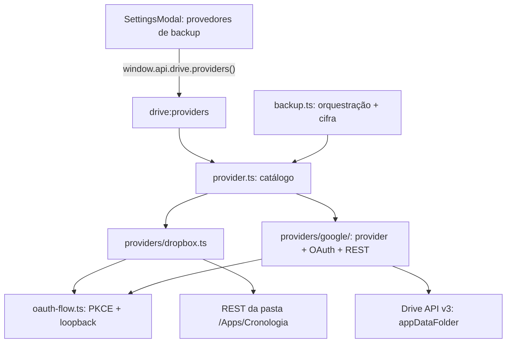

# Provedores de backup

O app fala com serviços de nuvem por um contrato único (`BackupProvider`). A
orquestração e a criptografia do backup são compartilhadas; OAuth, REST e
armazenamento remoto ficam em adaptadores separados. O guia específico do
Dropbox está em [`dropbox.md`](dropbox.md).

## Estado dos provedores

| Provedor         | Disponibilidade                                                             | Destino                            |
| ---------------- | --------------------------------------------------------------------------- | ---------------------------------- |
| **Dropbox**      | Operante                                                                    | `/Apps/Cronologia` (pasta visível) |
| **Google Drive** | Operante em builds com `GOOGLE_CLIENT_ID`; caso contrário fica desabilitado | `appDataFolder` (pasta oculta)     |

Em Configurações, o catálogo explica quando o Google Drive não está disponível
neste build. Só provedores operantes aparecem no seletor. A escolha do usuário
é persistida em `settings.json`; os tokens de cada serviço ficam em entradas
separadas do cofre (`dropbox.tokens` e `google-drive.tokens`). Trocar de destino
não desconecta o outro.

## Google Drive

O adaptador usa Drive API v3 exclusivamente com o escopo `drive.appdata`, além
de `userinfo.email` para mostrar a conta conectada. Todos os arquivos são
criados na pasta oculta `appDataFolder`; o app não lista nem acessa o Drive
visível do usuário. O conteúdo continua cifrado com AES-256-GCM e os nomes
remotos continuam opacos, como no Dropbox.

### Credenciais e build

O `client_id` identifica o app OAuth Desktop e é necessário para habilitar o
provedor. Para desenvolvimento, copie `.env.example` para `.env` e informe
`GOOGLE_CLIENT_ID`; `GOOGLE_CLIENT_SECRET` é opcional para o cliente Desktop.
Se fornecido, o valor também é embutido no bundle main. Um segredo de cliente
incluído em um aplicativo desktop distribuído **não é confidencial** e não deve
ser tratado como barreira de segurança; a proteção do fluxo é PKCE.

No GitHub Actions, configure `GOOGLE_CLIENT_ID` em **Settings → Secrets and
variables → Actions** (aba **Variables** é o lugar certo, porque o valor é um
identificador público de cliente Desktop; a aba **Secrets** também é lida) para
incluir a integração nas Releases; `GOOGLE_CLIENT_SECRET` é opcional. O
workflow de publicação injeta os valores no build, nunca no código-fonte, e
falha com mensagem explícita se `GOOGLE_CLIENT_ID` estiver ausente (ver
`docs/build.md`). Sem o ID, o Dropbox continua operante e o Google Drive aparece
no catálogo como indisponível. O consentimento, os escopos e o estado de
publicação do app OAuth também precisam estar configurados no Google Cloud
Console conforme as regras vigentes do Google.

### Fluxos e detalhes da API

- OAuth Authorization Code com PKCE S256, servidor loopback em porta efêmera,
  `access_type=offline` e `prompt=consent`.
- Tokens armazenados apenas no cofre, separados por provedor; o access token é
  renovado perto da expiração e após um 401, com uma única repetição da chamada.
- Listagem percorre `nextPageToken` até o fim e valida a resposta fail-closed.
- Criação usa upload multipart com metadados `name` e parent `appDataFolder`.
  Atualizações usam `PATCH` media no arquivo existente para não apagar o backup
  anterior antes de confirmar o conteúdo novo. Duplicatas são removidas só após
  o upload bem-sucedido.
- Download usa `alt=media`; remoção aceita 404 como já removido.

## Arquitetura

| Arquivo                               | Papel                                                |
| ------------------------------------- | ---------------------------------------------------- |
| `src/main/drive/provider.ts`          | Contrato, catálogo e provedor ativo                  |
| `src/main/drive/providers/dropbox.ts` | Adapter do OAuth/REST do Dropbox                     |
| `src/main/drive/providers/google/`    | Credenciais, OAuth, sessão, REST e adapter do Google |
| `src/main/drive/oauth-flow.ts`        | Fluxo OAuth/PKCE e loopback compartilhado            |
| `src/main/drive/backup.ts`            | Orquestração genérica de backup/restauração          |
| `src/main/drive/crypto.ts`            | Criptografia e nomes remotos opacos                  |
| `src/main/drive/state.ts`             | Provedor selecionado e sessões guardadas no cofre    |

Os textos do catálogo (`label`, disponibilidade e destino) são montados por
`describe(messages)` no idioma corrente; mensagens ficam em `src/messages/`.
