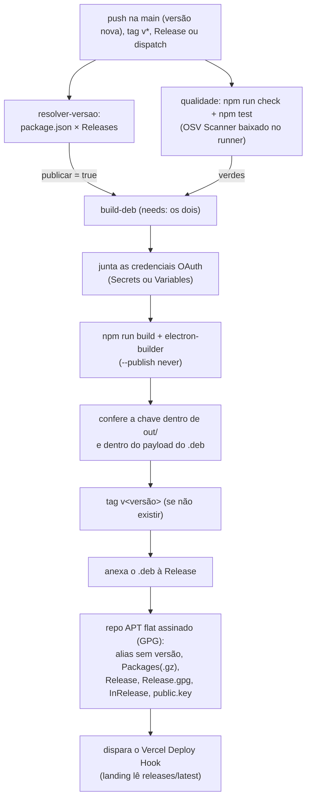

# Build, pacote e distribuição

O app é compilado com electron-vite (`main`, `preload` e `renderer`) e
empacotado em `.deb` pelo electron-builder. Nada disso entra no git: `out/`,
`release/` e `*.deb` estão no `.gitignore`.

## Comandos

| Comando                   | O que faz                                                    |
| ------------------------- | ------------------------------------------------------------ |
| `npm ci`                  | dependências (lockfile exato)                                |
| `npm run dev`             | desenvolvimento com hot reload (log do Chromium no terminal) |
| `npm run dev:inspect`     | `dev` + V8 inspector do processo main, porta 5858            |
| `npm run dev:inspect-brk` | idem, pausando na primeira linha até anexar o depurador      |
| `npm run build`           | apaga `out/` e compila os três bundles                       |
| `npm start`               | pré-visualiza o build (`electron-vite preview`)              |
| `npm run dist`            | build + gera o `.deb` em `release/` (precisa `fakeroot`)     |
| `npm run dist:dir`        | idem, deixando a árvore descompactada (`--dir`)              |
| `npm run check`           | typecheck + lint + formato + auditoria OSV                   |
| `npm test`                | suíte Vitest (`tests/`)                                      |
| `npm run test:coverage`   | suíte com cobertura em `coverage/` (limiar de 50%)           |

`ELECTRON_ENABLE_LOGGING=1` entra em todos os scripts de `dev`: é o que faz o
Chromium (GPU, rede, sandbox) escrever no terminal junto com o
`console.warn`/`console.error` do app. Já o `--inspect` **não** pode funcionar
no binário instalado — o fuse `enableNodeCliInspectArguments` está em `false`
(`package.json` → `build.electronFuses`) para que o usuário final não abra um
depurador no processo que tem a chave-mestra em memória. Uso prático em
[`testes.md`](testes.md) § "Depuração".

Pré-requisitos: Node 24 + npm 11 e `fakeroot` no Linux para o `dist`. O binário
`bin/osv-scanner` (usado por `security:audit`) não é versionado; localmente
copie uma release (2.6.0) e no CI ele é baixado pelo próprio workflow.

## Saída do build

| Caminho                 | Conteúdo                                               |
| ----------------------- | ------------------------------------------------------ |
| `out/main/index.js`     | processo principal (bundled pelo Vite em SSR)          |
| `out/preload/index.cjs` | ponte `contextBridge` (CommonJS, exigida pelo sandbox) |
| `out/renderer/`         | HTML, CSS, fontes e JS da interface                    |
| `release/`              | `.deb` e árvore gerada pelo electron-builder           |

Os aliases `@zero/*` são resolvidos na hora do bundle
(`electron.vite.config.mts`), então o pacote não depende do `tsconfig` em
tempo de execução.

## O que vai dentro do `.deb`

Bloco `build` do `package.json`:

| Chave                 | Valor                                                             |
| --------------------- | ----------------------------------------------------------------- |
| `appId`               | `com.cronologia`                                                  |
| `target`              | `deb` para Linux (categoria Office, executável `cronologia`)      |
| `asar`                | ligado (o código vive no `app.asar`)                              |
| `afterPack`           | `build/after-pack.cjs` (slim: locales e SwiftShader removidos)    |
| `deb.appArmorProfile` | `build/apparmor-profile` (perfil AppArmor real, não o decorativo) |
| `deb.afterInstall`    | `build/scripts/after-install.sh` (dirs do cofre + PolicyKit)      |
| `deb.afterRemove`     | `build/postrm` (unload do perfil, alternatives e purge)           |
| `extraResources`      | `build/scripts/cronologia-setup` → `resources/cronologia-setup`   |
| `depends`             | GTK 3, libnotify, NSS, xss, xtst, xdg-utils, atspi e uuid         |
| `electronFuses`       | 6 fuses apertados (abaixo)                                        |

### Fuses (`electronFuses`)

| Fuse                                   | Valor   | Por quê                                                      |
| -------------------------------------- | ------- | ------------------------------------------------------------ |
| `runAsNode`                            | `false` | não deixar `ELECTRON_RUN_AS_NODE` executar Node              |
| `enableNodeOptionsEnvironmentVariable` | `false` | bloqueia `NODE_OPTIONS` injetado por fora                    |
| `enableNodeCliInspectArguments`        | `false` | inspetor (`--inspect`) desligado                             |
| `enableCookieEncryption`               | `true`  | cookies cifrados no perfil                                   |
| `onlyLoadAppFromAsar`                  | `true`  | código só do `app.asar`                                      |
| `grantFileProtocolExtraPrivileges`     | `false` | sem privilégios extra do `file://` (a SPA é `cronologia://`) |

### `after-pack.cjs` (slim)

Remove do pacote o que o app não usa: `locales/` além de `pt-BR`, `pt-PT` e
`en-US` (fallback obrigatório do Chromium) e os binários SwiftShader/Vulkan
(sem WebGL). **Nunca** remover `libffmpeg.so`: o binário do Electron declara
`DT_NEEDED` nele e o app não abre sem o arquivo (lição da v1.1.1).

### Perfil AppArmor (`build/apparmor-profile`)

O `postinst` padrão do electron-builder copia o perfil para
`/etc/apparmor.d/cronologia` e o carrega, **pulando** (sem falhar) onde
AppArmor é antigo (base < `abi/4.0`, ex.: Mint 22 sobre 22.04) ou ausente. Sem
essa chave, o que o `.deb` embutiria seria o perfil decorativo padrão
(`flags=(unconfined)`, que só dá nome ao processo). O perfil real confina o
processo instalado:

- **escrita** só nos diretórios do app no home (`.config`/`.local/share`/
  `.cache`/`.local/state/cronologia`), no cofre de
  `/var/lib/.cronologia` (raiz `r`, vault `rw`) e no helper do pacote;
- **leitura** do home ampla (o seletor de capa abre arquivo de qualquer pasta),
  de `/media/**` e `/run/media/**` (pendrive e cartão, que o Mint monta fora do
  home), com deny-list de credenciais (`.ssh`, `.gnupg`, chaveiros, perfis de
  navegador inclusive Brave, cofre/Cookies do Guardinha, `.aws`, `.docker`,
  `.kube`, `.netrc`, `.git-credentials`); os diretórios críticos têm regra de
  dir porque `/**` não cobre o próprio diretório;
- **socket do IBus** em `~/.cache/ibus/dbus-*`: `<abstractions/ibus>` só cobre
  o peer **abstrato** `@/home/*/...`, e a regra concreta está comentada lá
  dentro por causa do LP#1856738;
- **exec** só do binário do pacote e do `xdg-open` (URLs externas);
- **rede** `inet`/`inet6` em `stream` e `dgram` (HTTPS e DNS do Dropbox), sem
  sockets crudos; AppArmor clássico não filtra host de destino (aceito no
  `SECURITY.md`);
- base do Electron/GTK (namespaces, capabilities, `/proc`, abstrações X/Wayland,
  dbus e fontes).

**Limitação conhecida:** o perfil não dá `w` nos pais XDG (`~/.config`,
`~/.local/share`, `~/.cache`), de propósito. Liberar o pai deixaria o app
capaz de criar entradas arbitrárias em `.config`. Numa sessão normal esses
diretórios já existem (o login os cria); só num home recém-criado o `mkdir`
inicial é negado e o app abre em modo degradado. A falha de persistência vira
`error` no log, sem derrubar a janela; consulte `initApp` em `docs/arquitetura.md`.
Se esse cenário virar requisito, acrescente a regra de pai e registre o custo
de permissão aqui.

O perfil usa as macros `${executable}`/`${sanitizedProductName}`, que o
electron-builder substitui na hora do build. Validação de sintaxe local:

```bash
apparmor_parser --skip-kernel-load --debug build/apparmor-profile
```

**Ciclo de teste em uma máquina real (obrigatório após cada regra nova):**
carregar em modo complain (`sudo apparmor_parser -C -r
/etc/apparmor.d/cronologia`), usar o app de ponta a ponta, ler as
negações (`journalctl -k | grep DENIED` ou `/var/log/kern.log`) e repetir até
zerar negações legítimas; só então voltar ao modo enforce
(`sudo apparmor_parser -r /etc/apparmor.d/cronologia`). Negação
legítima é sinal de regra faltando, **nunca** de regra a remover. A remoção do
pacote (`postrm` abaixo) descarrega e apaga o perfil.

Dois aprendizados do ciclo real (2026-10-09, Linux Mint 22.3): as regras
`deny` explícitas da deny-list negam **sem** gerar linha no journal. Valide
a deny-list com um teste de leitura direto (EACCES), não pelo log; e o
seletor de capa roda no `xdg-desktop-portal` do sistema, fora do confinamento
(a mediação do perfil acontece na leitura que o próprio app faz do arquivo
escolhido). O registro completo do ciclo está no `ROADMAP.md` (item 6.3, na
raiz do monorepo).

**O ciclo tem que cobrir a digitação com IME, não só as telas.** Este foi o
defeito que a deny-list mascarou (2026-10-18): o build instalado recusava o
socket concreto do IBus, então a tecla entrava no método de entrada e não
voltava como caractere. Como senha e PIN são `<input type="password">` e não
passam pelo IME, o sintoma parecia isolado: campos de texto de verdade (busca,
sinopse, frase de recuperação) ficavam mudos enquanto os de senha digitavam
normal, e `npm run dev` não reproduzia nada porque roda sem perfil. A regra
para o caso é: **quando um campo de texto do produto parece quebrado só no
build instalado, o perfil é o primeiro suspeito** — e o sintoma "só alguns
campos" é a assinatura de um bloqueio que só alcança o caminho do IME.

Verificação sem root, útil para pegar erro de digitação do arquivo antes de
empacotar (compara as regras novas com as do projeto de referência):

````bash
sed -E 's/\$\{executable\}/cronologia/g; s/\$\{sanitizedProductName\}/Cronologia/g' \
  build/apparmor-profile > /tmp/cronologia.profile
apparmor_parser --skip-kernel-load --debug /tmp/cronologia.profile
apparmor_parser --preprocess /tmp/cronologia.profile | grep -nE 'ibus|/media'

### `after-install` (postinst) e o helper do cofre

`build/scripts/after-install.sh` é o `postinst` custom (`deb.afterInstall`),
com o template padrão do electron-builder **mais** o que o cofre precisa:

- `install -d -m 0711 root:root /var/lib/.cronologia` (oculta, sem
  listagem) e `install -d -m 0700 <SUDO_UID|PKEXEC_UID>` para
  `/var/lib/.cronologia/.vault`. Se o instalador não for
  identificado, o app repara a pasta no primeiro uso;
- a ação do PolicyKit `com.cronologia.setup-vault`
  (`/usr/share/polkit-1/actions/com.cronologia.policy`), que autoriza
  **só** o helper do pacote (`annotate` com o caminho absoluto);
- normalização do dono/modo de `resources/cronologia-setup` (o build pode
  gravar com outro dono; `pkexec` exige root e sem escrita do grupo).

O helper `build/scripts/cronologia-setup` (copiado por `extraResources` para
`resources/`) roda como root via `pkexec`, **não** aceita caminho do chamador
e só cria os dois diretórios fixos com os modos acima, dando o dono do vault a
`PKEXEC_UID`. É ele que o `src/main/vault/privilege.ts` chama quando o app
não consegue escrever em `/var/lib`.

### `postrm` (after-remove)

Substitui o template padrão (via `deb.afterRemove`; roda pelo `writeConfigFile`,
que resolve os placeholders de nome). No No `remove` comum: remove o `update-alternatives`, **descarrega o perfil
AppArmor do kernel** e apaga o arquivo (sem isso a policy ficaria imposta até
o reboot), e apaga a ação do PolicyKit (fora do banco do dpkg). No `apt
purge`, apaga também os dados do usuário em todos os homes
(`.config`/`.local/share`/`.cache`/`.state/cronologia`) **e o cofre
em `/var/lib/.cronologia`** (decisão de produto: purge leva junto).
Pastas de marcas antigas (`Cronologia`, `Webtoons Biblioteca`) não
são mais tocadas nem lidas.

## Integridade: check e testes antes do pacote

O gate **não é advisory**: o workflow `publish.yml` só chega ao
`electron-builder` depois de dois jobs verdes.

| Job               | O que roda                                                          |
| ----------------- | ------------------------------------------------------------------- |
| `resolver-versao` | confere `package.json` × Releases; decide se há o que publicar      |
| `qualidade`       | `npm ci` → baixa o OSV Scanner → `npm run check` → `npm test`       |
| `build-deb`       | `needs: [resolver-versao, qualidade]` → build + tag + Release + APT |

Falha de tipo, lint, formato, vulnerabilidade ou teste derruba o run **antes**
de qualquer tag ou asset existir. `resolver-versao` e `qualidade` rodam em
paralelo.

Localmente, o equivalente ao gate é:

```bash
npm ci && npm run check && npm test
````

## O `quality.yml` (gate do dia a dia)

O `publish.yml` só dispara na `main` quando há versão nova (e nos gatilhos de
reserva), então o push comum e o pull request têm gate próprio em
`.github/workflows/quality.yml`:

| Job                   | Quando                     | O que roda                                                                   |
| --------------------- | -------------------------- | ---------------------------------------------------------------------------- |
| `Verificar qualidade` | push na `main`, PR         | `npm run check` (typecheck inclui `e2e/`, lint, formato, OSV)                |
| `Testes e cobertura`  | push na `main`, PR         | `npm run test:coverage` + resumo na página da execução                       |
| `Testes E2E`          | push na `main`, PR         | `npm run dist:dir` → `xvfb-run npm run test:e2e` → instalação real do `.deb` |
| `Testes de mutação`   | **só `workflow_dispatch`** | `npm run test:mutation` (pisos `min_score`/`mutation_file` são inputs)       |

O job de mutação não entra em PR nem em push de propósito: a varredura leva
horas e o número que ela mede só muda quando alguém escreve teste novo. Aparece
como _Skipped_ na aba de checks, e não é status check obrigatório. Piso
configurável por disparo manual.

A sobreposição entre `quality.yml` e o job `qualidade` do `publish.yml` é
intencional: o `publish.yml` precisa ser autossuficiente para a tag `v*` e para
Release criada na UI, que o `quality.yml` não vê.

Detalhe dos fluxos E2E e da varredura: [`e2e.md`](e2e.md) e
[`mutation.md`](mutation.md).

## Imagem do runner e runtime das actions

Os quatro workflows rodam em `ubuntu-24.04` **fixado**, nunca em
`ubuntu-latest`. O `latest` é etiqueta móvel: em outubro de 2026 o GitHub
começou a apontá-lo para o Ubuntu 26.04
([actions/runner-images#14748](https://github.com/actions/runner-images/issues/14748)),
e a troca sozinha mudaria o ambiente de build — o `.deb` que o usuário instala
e os testes que o verificam — sem nenhuma decisão nossa. O job de E2E é o mais
sensível: ele instala dependências de janela pelo nome do pacote Ubuntu
(`libgtk-3-0t64`, `libatk1.0-0t64`, `libasound2t64`, `fakeroot`) e instala o
`.deb` de verdade, então um nome de pacote que mudou derrubaria o gate sem que
ninguém tivesse tocado em nada.

Para sair do 24.04: troque para `ubuntu-26.04` nos quatro arquivos, suba um job
que só instala as dependências do E2E, e só depois mova os outros. Subir sem
esse teste é trocar um `.deb` validado por um `.deb` não validado.

Todas as actions estão fixadas por SHA **e** em Node 24 (`using: node24`): o
Node 20 foi descontinuado e saiu dos runners em 23/09/2026, então uma action em
Node 20 não roda mais — o runner a força para Node 24 e avisa a cada execução.
O Dependabot (`github-actions`) atualiza os pins.

## Fluxo do `publish.yml`



### Credenciais OAuth embutidas no `.deb`

O `publish.yml` injeta as chaves de cliente do Dropbox e do Google Drive no
bundle do processo main (o `define` de `electron.vite.config.mts`), e o passo
**"Conferir que as credenciais entraram no bundle do main"** abre o `.deb`
gerado e verifica que a chave está lá dentro. Sem essa conferência, uma variável
com nome errado geraria um pacote com o provedor desabilitado e a falha só
apareceria na máquina de quem instalou.

Onde cadastrar, em **Settings → Secrets and variables → Actions** (escopo
_Repository_):

| Variável                 | Aba         | Obrigatória                                                                                                |
| ------------------------ | ----------- | ---------------------------------------------------------------------------------------------------------- |
| `DROPBOX_APP_KEY`        | Variables¹  | Sim: sem ela o Dropbox sai desabilitado                                                                    |
| `GOOGLE_CLIENT_ID`       | Variables¹  | Sim: sem ela o Google Drive sai desabilitado                                                               |
| `GOOGLE_CLIENT_SECRET`   | Variables¹  | Não: o cliente Desktop funciona só com o ID                                                                |
| `GPG_PRIVATE_KEY`        | Secrets     | Sim: assina o repo APT                                                                                     |
| `GPG_FINGERPRINT`        | no workflow | Não é secret: impressão digital da chave, no `env:` do `publish.yml`; confere o que `GPG_PRIVATE_KEY` traz |
| `GPG_PASSPHRASE`         | Secrets     | Só se a chave PGP tiver senha                                                                              |
| `VERCEL_DEPLOY_HOOK_URL` | Secrets     | Não: sem hook a Release funciona igual                                                                     |

¹ O workflow lê `secrets.*` **e** `vars.*` com o mesmo nome, e o secret vence se
os dois existirem. `Variables` é o lugar certo para as três chaves OAuth porque
elas identificam o aplicativo e não são segredos de servidor: qualquer pessoa
consegue extraí-las do binário instalado, e é o PKCE que protege a troca de
autorização.

Faltando `DROPBOX_APP_KEY` ou `GOOGLE_CLIENT_ID`, o job **trava antes de
empacotar**, com `::error::` apontando o lugar certo da tela.

Detalhes da distribuição (por que o repo APT vive na Release, nomes dos
assets que **nunca** se renomeiam, troubleshooting do GPG):
[`distribuicao-apt.md`](distribuicao-apt.md). A landing nunca versiona
binário: o `fetch-release.mjs` dela lê `releases/latest` no build.

## Ver também

- [`distribuicao-apt.md`](distribuicao-apt.md) (Release + repo APT + landing)
- [`testes.md`](testes.md) (o que o gate de testes cobre)
- [`e2e.md`](e2e.md) (o job de E2E, app compilado e payload do `.deb`)
- [`mutation.md`](mutation.md) (o job de mutação, por disparo manual)
- [`SECURITY.md`](../SECURITY.md) (fuses, CSP e permissões da sessão)
